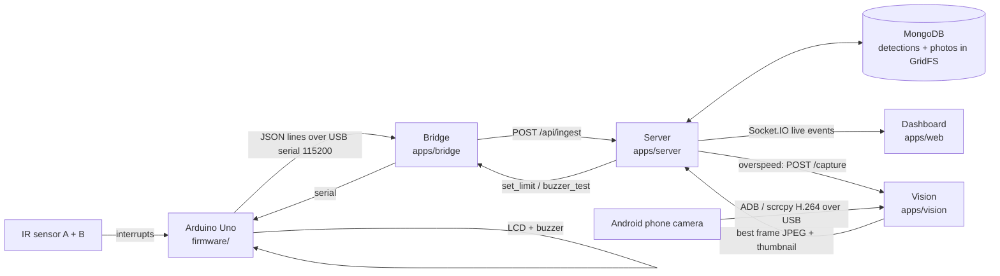

# Smart Speed Detection

IoT vehicle speed detection (APSIT · IOE mini project). Two IR sensors on an
Arduino time a (toy) vehicle crossing a 10 cm gate. Every crossing streams to a
real-time web dashboard; **overspeeding** vehicles trigger the buzzer + LCD
alert and get a **phone-camera snapshot** stored with the detection.

- Live dashboard: KPIs, speed gauge, live ticker, charts, **overspeed evidence** photo grid
- Detections table with photo drawer, review workflow, CSV/PDF export
- Live map, analytics, camera preview, three roles (admin / authority / user)

> `prompt.md` is the original full specification the project was built from.

## How it works



1. **Arduino** (`firmware/`) timestamps both sensors with `micros()`, computes
   `speed = 0.10 m / dt`, shows it on the LCD, beeps 3× if over its limit and
   prints one JSON line per vehicle.
2. **Bridge** (`apps/bridge`) reads the serial port, validates each line, adds
   the Mac's time and forwards it to the server (with a disk queue so nothing is
   lost if the server restarts). It also pushes the speed limit back to the Arduino.
3. **Server** (`apps/server`) multiplies by the station's **scale factor**
   (toy → real-world speed), decides overspeed, stores the detection and pushes it
   to every open dashboard over Socket.IO.
4. **Vision** (`apps/vision`) streams the phone camera into a 3-second memory
   buffer. For overspeed detections it picks the sharpest frame showing the
   moving vehicle, boxes it, and uploads it; the server stores it in MongoDB GridFS.
5. **Web** (`apps/web`) — React dashboard; updates live within ~1 s.

| Path              | What                                               | Stack                                   |
| ----------------- | -------------------------------------------------- | --------------------------------------- |
| `firmware/`       | Arduino sketch + wiring + serial protocol docs     | C++ (Arduino / PlatformIO)              |
| `packages/shared` | Zod schemas & types shared by server, bridge, web  | TypeScript                              |
| `apps/server`     | REST API, auth/roles, ingest, analytics, Socket.IO | Node, Express, Mongoose                 |
| `apps/bridge`     | USB serial ⇄ server                                | Node, serialport                        |
| `apps/vision`     | Phone camera capture service                       | Python, FastAPI, OpenCV, PyAV           |
| `apps/web`        | Dashboard                                          | React, Vite, Tailwind, ECharts, Leaflet |

## Hardware & wiring (this build)

| Part                | Arduino pin                          |
| ------------------- | ------------------------------------ |
| IR sensor A (IN)    | D2 (INT0)                            |
| IR sensor B (OUT)   | D3 (INT1)                            |
| Buzzer (+)          | **D13** (onboard LED blinks with it) |
| 16×2 I2C LCD (0x27) | SDA → A4, SCL → A5                   |
| Camera              | Android phone (Pixel 9a) over USB    |

Sensors must be **10 cm apart** (`GATE_DISTANCE_M` in `firmware/src/main.cpp`).
Details and the serial protocol: [`firmware/README.md`](firmware/README.md).

## Setup (macOS)

```bash
# tools
brew install node pnpm uv scrcpy arduino-cli     # scrcpy also brings adb

# JS dependencies (+ builds packages/shared)
pnpm install && pnpm build

# Python env for the camera service
uv venv -p 3.12 apps/vision/.venv
uv pip install -p apps/vision/.venv -r apps/vision/requirements.txt

# env files — copy every example, then set real secrets
for d in apps/server apps/bridge apps/web apps/vision; do cp $d/.env.example $d/.env; done
#   apps/server/.env : JWT_ACCESS_SECRET, JWT_REFRESH_SECRET, VISION_SHARED_SECRET (openssl rand -hex 32)
#   apps/vision/.env : VISION_SHARED_SECRET = same value as the server
```

### Flash the Arduino (once)

```bash
mkdir -p /tmp/fw && cp firmware/src/main.cpp /tmp/fw/ && echo "" > /tmp/fw/fw.ino
arduino-cli core install arduino:avr && arduino-cli lib install "LiquidCrystal I2C"
arduino-cli compile -b arduino:avr:uno /tmp/fw
arduino-cli upload  -b arduino:avr:uno -p /dev/cu.usbserial-XXXX /tmp/fw   # see `ls /dev/cu.*`
```

## Run (one terminal each, in this order)

```bash
pnpm dev:mongo      # 1. MongoDB on :27017 (no Docker needed; data in ./.data)
pnpm seed           # 2. first time only — prints logins + the DEVICE API KEY once
                    #    → put the key in apps/bridge/.env (DEVICE_API_KEY) and set SERIAL_PORT
pnpm dev            # 3. server :4000 + dashboard :5173
pnpm dev:bridge     # 4. Arduino serial bridge
pnpm dev:vision     # 5. phone camera service :8001  (close the phone's Camera app first)
```

Open **http://localhost:5173**. Seeded demo logins (password `Demo@1234`):
`admin@smartspeed.local`, `authority@smartspeed.local`, `driver@smartspeed.local`.

> `docker compose up mongo` also works for step 1. The `server`/`web` services in
> `docker-compose.yml` need Dockerfiles that are not written yet.

### Calibration for toy cars

A hand-pushed toy only reaches ~3–20 km/h over a 10 cm gate. Set the station's
**scale factor** (Devices page, admin) — e.g. `10` treats the toy as a 1:10
model: measured 5 km/h → shown 50 km/h. The server pushes `limit ÷ scale` to the
Arduino so the buzzer and the dashboard agree.

### Where photos are stored

In MongoDB **GridFS**, bucket `frames` (`<detectionId>.jpg` + `.thumb.jpg`),
linked from `detection.frame.fileId`. Only overspeed detections get a photo.
View them on the Dashboard (Overspeed evidence) or Detections page.

## Tests

```bash
pnpm test                                   # shared, server, bridge, vision, web
cd apps/vision && .venv/bin/pytest -q       # vision only
```

Known issue: `apps/web/src/components/layout/nav.test.ts` still expects the
nav without the Sessions page (2 failing assertions).

## Troubleshooting

| Symptom                           | Fix                                                                                            |
| --------------------------------- | ---------------------------------------------------------------------------------------------- |
| Bridge connects but no detections | Arduino must run `firmware/` (prints `{"t":"hello",...}` on boot). Check `SERIAL_PORT`.        |
| Camera `waiting` / no frames      | `adb devices` lists the phone? Phone unlocked, **Camera app closed**, `scrcpy` installed.      |
| Photo doesn't show the car        | Phone 30–40 cm away and **out of the car's path**; light-coloured toy; keep hands out of view. |
| Speeds never over the limit       | Raise the scale factor (see Calibration).                                                      |
| LCD blank                         | Address `0x27` → `0x3F` in `firmware/src/main.cpp`, turn the contrast pot.                     |
